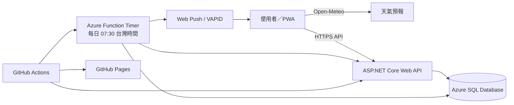

# Weather Outfit｜每日天氣穿搭提醒

手機優先、也支援桌機瀏覽的 PWA。使用者選擇台灣縣市或目前位置、場合與個人偏好後，網站會依當日天氣提供可解釋的穿搭推薦；啟用提醒後，每天早上會收到一則簡短的天氣與穿搭通知。

- 網站 Demo：https://jhen-h.github.io/WEATHER-OUTFIT/
- 原始碼：https://github.com/Jhen-H/WEATHER-OUTFIT

## 作品亮點

- 全台 22 個縣市、目前位置、今天／明天／未來 7 天氣象資訊。
- 今日與明日提供完整穿搭推薦；一週模式聚焦顯示天氣。
- 依最高／最低溫、日夜溫差、降雨機率、紫外線、風速、場合與使用者偏好篩選。
- 可選女裝／男裝呈現、常穿單品、最多三種色系與預設場合。
- 收藏穿搭、推薦原因、天氣情境背景與完整穿搭照片。
- 可加入主畫面使用，並支援基本離線 App Shell。
- 在 iOS 加入主畫面並允許通知後，可接收每日 Web Push 提醒。

## 系統架構



## 技術選擇

| 技術 | 用途 |
| --- | --- |
| React + TypeScript + Vite | 前端元件、互動、型別檢查與靜態建置。 |
| CSS | 手機優先的響應式介面與依天氣改變的背景。 |
| Open-Meteo API | 取得氣溫、降雨機率、UV、風速與天氣狀態。 |
| Web Manifest + Service Worker | PWA 安裝、基本離線畫面與接收 Push。 |
| ASP.NET Core Web API (.NET 10) | 裝置註冊、提醒設定、VAPID 公鑰與測試推播。 |
| Azure SQL Database | 儲存裝置、Push 訂閱與提醒城市／時間。 |
| Azure Functions Timer Trigger | 每天台灣時間 07:30 讀取提醒資料並送出 Web Push。 |
| Azure App Service | 部署 Web API。 |
| GitHub Pages + GitHub Actions | 部署前端與自動化部署 API／Function。 |

## 推薦規則

推薦邏輯刻意採用可說明、可測試的規則，而非黑箱模型：

1. **天氣安全性優先**：雨天限定造型只在降雨機率高時出現；怕雨造型在雨天排除；同時檢查高低溫、UV 與日夜溫差。
2. **情境一致性**：場合與女裝／男裝呈現先做硬篩選。
3. **個人偏好排序**：符合勾選衣物與色系的候選優先；素材不足時才降級為最接近、但仍符合天氣安全條件的推薦，並在 UI 說明原因。
4. **通知與完整推薦分工**：通知只提供當日預報與簡短穿搭方向；點開後由前端呈現完整照片與搭配清單。

## 每日提醒如何運作

1. 使用者在偏好頁啟用每日提醒，瀏覽器建立 Push 訂閱。
2. 前端把裝置、提醒時間與目前選擇的城市傳到 API，API 寫入 Azure SQL。
3. Azure Function 每天 **台灣時間 07:30** 執行（固定使用 UTC 23:30，避免雲端時區設定造成偏差）。
4. Function 讀取已啟用的裝置，向 API 取得該城市的當日預報摘要，再以 VAPID 發出 Web Push。

通知中的「目前晴天；今天預報可能有雨」並不衝突：前半段是即時天氣，後半段是全天的最高降雨機率預報。

## 本機啟動

### 前端

```bash
pnpm install
pnpm dev
```

通常會啟動在 `http://127.0.0.1:5173/`。此網址只存在於本機；對外請使用 GitHub Pages Demo。

正式建置：

```bash
pnpm build
```

### API 與提醒 Function

API 和 Function 需要設定下列機密，**不可提交到 Git**：

- `ConnectionStrings__WeatherOutfit`：Azure SQL 連線字串
- `Vapid__Subject`
- `Vapid__PublicKey`
- `Vapid__PrivateKey`

本機啟動 API：

```bash
dotnet run --project server/WeatherOutfit.Api --urls http://127.0.0.1:5099
```

正式環境的值放在 Azure App Settings；GitHub Actions 使用 Azure OIDC 身分部署，不使用 publish profile。

## 專案結構

```text
src/
  App.tsx                         首頁、偏好、收藏與互動
  weather.ts                      台灣城市座標與 Open-Meteo 資料轉換
  outfitCatalog.ts                照片的場合、偏好與天氣標籤
  recommendation.ts               穿搭推薦規則與候選排序
  pushReminder.ts                 瀏覽器訂閱與提醒 API 呼叫
  preferences.ts                  瀏覽器本機偏好與收藏
  styles.css                      手機優先與桌機響應式樣式
server/
  WeatherOutfit.Api/              ASP.NET Core API、Azure SQL、Web Push
  WeatherOutfit.Reminders/        Azure Function 每日定時推播
public/
  outfits/                        完整穿搭照片素材
  preference-clothing/            偏好設定的服飾圖卡
```

## 已知限制與取捨

- iOS 必須使用 Safari 將網站「加入主畫面」，並允許通知，才能在背景收到 Web Push。
- 偏好與收藏目前存在瀏覽器 localStorage，尚未提供帳號與跨裝置同步；提醒訂閱與提醒城市則存於 Azure SQL。
- 免費或低階 App Service／Azure SQL 可能有冷啟動，UI 會保留載入與失敗提示。
- 目前照片為示範素材；新增服飾類型時，需要同時建立素材與正確的推薦標籤。
- 定時提醒以雲端服務執行，不依賴開發者電腦是否開機。

## 後續改善方向

1. 推播可靠度：通知紀錄、防重複發送、失效訂閱清除與 Application Insights 告警。
2. 安全性：提醒設定的裝置憑證、API rate limit、精確定位資料最小化。
3. 測試：為 `recommendation.ts` 建立雨天、溫差與偏好降級的單元測試。
4. UX：加強離線、定位失敗與服務冷啟動的提示。
5. 跨裝置同步：以帳號系統或匯出／匯入功能逐步導入。
